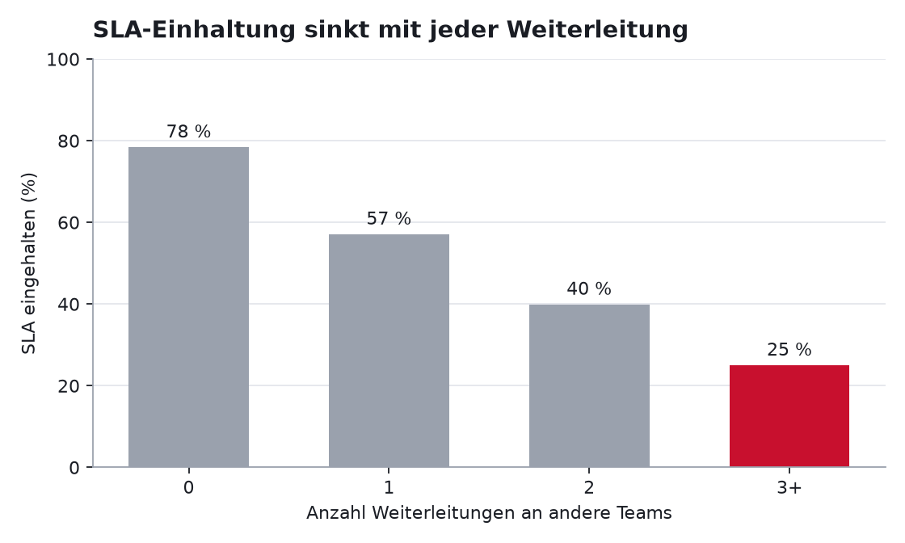
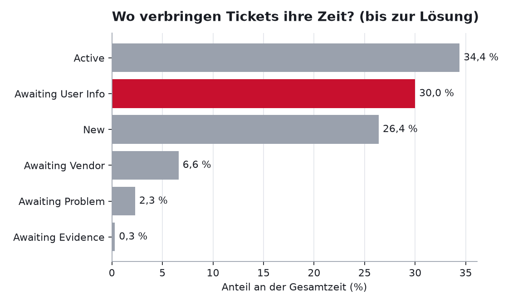

# IT-Ticket-Analyse – Wo der Incident-Prozess Zeit und SLA verliert

Analyse von **24.918 echten IT-Incident-Tickets aus ServiceNow** (141.712 Statusänderungen, Feb. 2016 – Feb. 2017):
Kennzahlen mit **SQL**, Auswertung mit **Python**, **Excel-Dashboard**, **Prozessmodell (Ist/Soll)** und
**PowerPoint-Präsentation** mit Handlungsempfehlungen.


## Ergebnisse auf einen Blick

| Kennzahl | Wert |
|---|---|
| SLA eingehalten | 63,4 % |
| Tickets mindestens einmal weitergeleitet | 45,6 % |
| SLA-Quote ohne Weiterleitung → mit 3+ Weiterleitungen | 78,4 % → 25,0 % |
| Median-Lösungszeit ohne Weiterleitung → mit 3+ Weiterleitungen | 0,7 h → 191,8 h |
| Anteil der Zeit „Warten auf Nutzer“ | 30,0 % |



**Kernaussagen**
1. **Weiterleitungen sind der größte Hebel.** Je öfter ein Ticket zwischen Teams wandert, desto seltener wird das SLA eingehalten.
2. **Viel Zeit vergeht mit Warten**, vor allem auf Rückmeldungen der Nutzer (30 %) und vor der ersten Bearbeitung (26 %).
3. **Große Unterschiede zwischen Teams:** von 42 % bis 89 % SLA-Quote unter den 10 größten Teams.

Empfohlene Maßnahmen und Ist-/Soll-Prozess: **[docs/prozess.md](docs/prozess.md)**



## Ergebnisse

| Datei | Inhalt |
|---|---|
| [`output/Ticket_Dashboard.xlsx`](output/Ticket_Dashboard.xlsx) | Excel-Dashboard: Kennzahlen, native Excel-Diagramme, bedingte Formatierung |
| [`output/Ticket_Analyse.pptx`](output/Ticket_Analyse.pptx) | Präsentation (8 Folien): Management Summary, Befunde, Ist/Soll-Prozess, Maßnahmen |
| [`docs/prozess.md`](docs/prozess.md) | Ist- und Soll-Prozess als Diagramm, Maßnahmen mit Messgrößen |
| [`sql/kpis.sql`](sql/kpis.sql) | Alle Kennzahlen als SQL-Abfragen (inkl. Window Functions `ROW_NUMBER`, `LEAD`) |
| [`output/diagramme/`](output/diagramme) | 6 Diagramme |
| [`output/tabellen/`](output/tabellen) | Ergebnistabellen als CSV |

## Vorgehen

1. **Daten laden** (`src/load_data.py`): CSV → SQLite. Pro Ticket wird per SQL der Endstand ermittelt
   (`ROW_NUMBER() OVER (PARTITION BY number ...)`).
2. **Kennzahlen** (`sql/kpis.sql`, `src/analyse.py`): SLA-Quote, Lösungszeiten (Mittelwert und Median),
   Weiterleitungen, Liegezeit je Status (`LEAD()` über die Statusänderungen), Team-Vergleich.
3. **Excel-Dashboard** (`src/excel_dashboard.py`) und **Präsentation** (`src/praesentation.py`)
   werden automatisch aus den Ergebnissen erzeugt.
4. **Prozessanalyse** (`docs/prozess.md`): Schwachstellen im Ist-Prozess, Soll-Prozess, Maßnahmen mit Messgrößen.

**Einschränkung:** Die Zusammenhänge sind Korrelationen, keine bewiesenen Ursachen
(komplexe Tickets werden z. B. häufiger weitergeleitet und dauern ohnehin länger).

## Selbst ausführen

```bash
python -m venv .venv
.venv\Scripts\activate          # Linux/macOS: source .venv/bin/activate
pip install -r requirements.txt
python run_all.py
```

Die Pipeline läuft zusätzlich bei jedem Push automatisch über GitHub Actions.

## Datenquelle

*Incident management process enriched event log* – C. Amaral, M. Fantinato, S. Peres,
UCI Machine Learning Repository, [doi:10.24432/C57S4H](https://doi.org/10.24432/C57S4H),
Lizenz [CC BY 4.0](https://creativecommons.org/licenses/by/4.0/). Die Rohdaten liegen unverändert in `data/raw/`.

## Technik

SQL (SQLite) · Python · pandas · matplotlib · openpyxl (Excel) · python-pptx (PowerPoint) · Mermaid (Prozessdiagramme) · GitHub Actions
