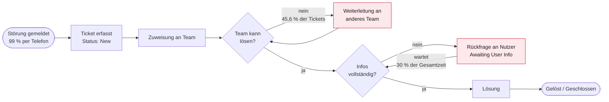
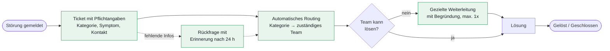

# Incident-Prozess: Ist und Soll

Grundlage: Analyse von 24.918 ServiceNow-Tickets (Feb. 2016 – Feb. 2017). Alle Zahlen stammen aus
`sql/kpis.sql` bzw. `output/kennzahlen.json`. Die Zusammenhänge sind Korrelationen, keine bewiesenen Ursachen.

## Ist-Prozess

**Schwachstellen (aus den Daten):**

| Schwachstelle | Beleg |
|---|---|
| Viele Weiterleitungen | 45,6 % der Tickets werden mindestens einmal weitergeleitet. SLA-Quote sinkt von 78,4 % (0 Weiterleitungen) auf 25,0 % (3+). Median-Lösungszeit steigt von 0,7 h auf 191,8 h. |
| Warten auf Nutzer | 30,0 % der Zeit bis zur Lösung liegt ein Ticket im Status „Awaiting User Info“. |
| Liegezeit nach Eingang | 26,4 % der Zeit bis zur Lösung liegt ein Ticket im Status „New“, also noch vor der Bearbeitung. |
| Kritische Tickets | Priorität 1 und 2 erreichen das SLA nur zu 1,9 % bzw. 0,5 %. |

## Soll-Prozess

## Maßnahmen

| # | Maßnahme | Begründung (Daten) | Messgröße |
|---|---|---|---|
| 1 | **Routing-Regeln** Kategorie → Team, regelmäßig aus den Weiterleitungsdaten nachgeschärft | Jede Weiterleitung geht mit deutlich niedrigerer SLA-Quote einher | Anteil weitergeleiteter Tickets (heute 45,6 %) |
| 2 | **Pflichtfelder / Checkliste** bei der Ticketerfassung | 30 % der Zeit wird auf Informationen vom Nutzer gewartet | Zeitanteil „Awaiting User Info“ (heute 30,0 %) |
| 3 | **Automatische Erinnerung** nach 24 h ohne Antwort, Eskalation danach | Wartezeiten blockieren die Lösung | Ø Dauer im Status „Awaiting User Info“ |
| 4 | **Dispatch-Ziel** für neue Tickets (z. B. Zuweisung innerhalb 1 h) | 26,4 % der Zeit liegen Tickets unbearbeitet im Status „New“ | Zeitanteil „New“ |
| 5 | **SLA-Definition für Priorität 1/2 prüfen**, eigener Eskalationspfad | SLA-Quote unter 2 % deutet auf unrealistische Ziele oder fehlende Eskalation | SLA-Quote Prio 1/2 |
| 6 | **Ursachenanalyse** in Teams unter Durchschnitt (z. B. Group 25, Group 20) | SLA-Quote 42–43 % bei überdurchschnittlich vielen Weiterleitungen | SLA-Quote je Team |
